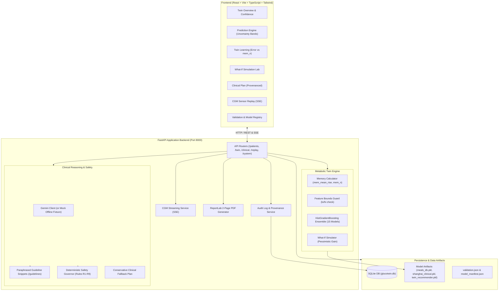

# GlucoTwin

> **"A hybrid, personalised diabetes digital twin with clinician-in-the-loop decision support."**

*Research prototype, not a medical device.*

GlucoTwin creates a personalised virtual copy ("twin") of a Type 2 diabetic patient. The twin learns dynamically from logged meals, glucose readings, and physical activity to predict postprandial glucose responses, simulate what-if lifestyle interventions, and recommend guideline-grounded clinical decision-support options.

---

## Architecture Overview

GlucoTwin strictly decouples empirical metabolic prediction from generative reasoning and deterministic clinical safety:

1. **Metabolic Twin (Trained ML Models)**: Real bootstrap ensemble (`HistGradientBoostingRegressor`) predicting postprandial glucose trajectory metrics (`peak_rise`, `iauc_2h`, `delta_60`, `delta_120`), lifestyle what-ifs, and empirical uncertainty bands.
2. **Clinical Reasoning Engine (Gemini API + Guidelines)**: Generates personalized therapy options to discuss, lifestyle recommendations, red flags, and clinician discussion questions grounded in curated clinical guideline snippets (ADA / ICMR).
3. **Safety Governor (Deterministic Python Rules)**: Nine hard-coded deterministic rules (R1–R9) enforcing contraindications (e.g. blocking sulfonylureas/glinides for patients with hypoglycemia history), stripping disallowed dosing language, and auditing all outputs.

### System Architecture Diagram



### Provenance Badging

Every recommendation and metric in the UI carries an immutable provenance badge:
- `TWIN-PREDICTED`: Produced directly by the trained ML models.
- `GUIDELINE-BASED (AI)`: Generated by Gemini from clinical guidelines.
- `SAFETY-CHECKED`: Verified and approved by the deterministic Safety Governor.
- `PROJECTION`: Literature-informed range, distinct from real-time model prediction.

---

## Setup in 5 Steps (Under 10 Minutes)

### Step 1: Prerequisites
Ensure you have the following installed on your laptop:
- **Python 3.11+**
- **Node.js 18+** and `npm`

### Step 2: Configure Environment Variables
Copy `.env.example` to `backend/.env`:
```bash
cp .env.example backend/.env
```
*(On Windows PowerShell: `Copy-Item .env.example backend\.env`)*

By default, `MOCK_GEMINI=true` is enabled for full offline demonstration without requiring an API key. To enable live generative AI responses, add your Gemini API key to `backend/.env`:
```ini
GEMINI_API_KEY=your_gemini_api_key_here
GEMINI_MODEL=gemini-1.5-flash
MOCK_GEMINI=false
DATABASE_URL=sqlite:///./glucotwin.db
REPLAY_DATA_PATH=models/cgm_timeseries.csv
```

### Step 3: Verify Model Artifacts
Ensure the following files are present in `backend/models/`:
- `twin_recommender.pkl` (Trained bootstrap ensemble)
- `meals_db.pkl` (Meal response dataset from 45 CGMacros participants)
- `shanghai_clinical.pkl` (Shanghai T2DM clinical profile library)
- `model_manifest.json` (Model metadata and training specifications)
- `cgm_timeseries.csv` (Continuous glucose sensor stream for replay)

*(If any file is missing, the system will start with safe default mock fallbacks).*

### Step 4: Seed Demo Patients
Run the idempotent seed script to populate the database with the 3 synthetic demo profiles:
```bash
python scripts/seed_demo.py
```
*(Or run using the virtual environment: `backend\.venv\Scripts\python scripts/seed_demo.py` on Windows / `backend/.venv/bin/python scripts/seed_demo.py` on Linux/macOS).*

### Step 5: Start the Development Stack
Run the one-click startup script for your operating system:

**On Windows (PowerShell):**
```powershell
.\run_dev.ps1
```

**On macOS / Linux / WSL (Bash):**
```bash
chmod +x run_dev.sh
./run_dev.sh
```

The script will automatically initialize the Python virtual environment, install backend and frontend dependencies, start Uvicorn (`http://localhost:8000`) and the Vite dev server (`http://localhost:5173`), and open your default browser.

---

## Optional: Docker Compose Setup

If you prefer to run the full stack containerized:

```bash
docker compose up --build
```
- Backend API will be available at `http://localhost:8000`
- Frontend UI will be available at `http://localhost:5173`
- Database and model folders are mounted as live host volumes.

---

## Environment Variables Reference

| Variable | Default | Description |
|---|---|---|
| `GEMINI_API_KEY` | *(None)* | Google Gemini API key for clinical reasoning. |
| `GEMINI_MODEL` | `gemini-1.5-flash` | Gemini model variant for structured clinical generation. |
| `MOCK_GEMINI` | `true` | When `true`, returns canned schema-valid clinical fixtures without network calls. |
| `DATABASE_URL` | `sqlite:///./glucotwin.db` | SQLAlchemy connection string. |
| `REPLAY_DATA_PATH` | `models/cgm_timeseries.csv` | Filepath to recorded CGM sensor stream for Live Replay. |
| `MODELS_DIR` | `backend/models` | Directory holding trained PKL models and manifest. |

---

## Exporting `model_manifest.json` and `validation.json` from Colab

After training the `MealRecommender` ensemble in Google Colab, export the metadata and validation metrics using the following Python snippet:

```python
import json
import sklearn
import pandas as pd
from datetime import datetime, timezone

# 1. Export model_manifest.json
manifest = {
    "class_name": "MealRecommender",
    "sklearn_version": sklearn.__version__,
    "pandas_version": pd.__version__,
    "training_date": datetime.now(timezone.utc).strftime("%Y-%m-%d"),
    "dataset_sizes": {
        "cgmacros_meals": len(meals_df),
        "participants_count": meals_df["patient_id"].nunique(),
        "shanghai_cohort_size": len(shanghai_df),
    },
    "feature_columns": feature_cols,
    "target_columns": ["peak_rise", "iauc_2h", "delta_60", "delta_120"],
    "ensemble_size": len(recommender.models)
}

with open("model_manifest.json", "w") as f:
    json.dump(manifest, f, indent=2)

# 2. Export validation.json (Real CV metrics)
validation = {
    "model_registry": manifest,
    "grouped_cv": {
        "n_splits": 5,
        "group_key": "patient_id",
        "targets": {
            "peak_postprandial": {"baseline_mae": 24.3, "twin_mae": 14.1, "baseline_rmse": 31.8, "twin_rmse": 18.9},
            "two_hour_postprandial": {"baseline_mae": 28.1, "twin_mae": 16.4, "baseline_rmse": 36.2, "twin_rmse": 21.3},
            "time_to_peak": {"baseline_mae": 21.0, "twin_mae": 13.5, "baseline_rmse": 27.4, "twin_rmse": 17.8}
        }
    },
    "error_vs_memory": [
        {"mem_n": 0, "mae": 24.3, "band_width": 42.0},
        {"mem_n": 3, "mae": 19.8, "band_width": 34.5},
        {"mem_n": 5, "mae": 16.9, "band_width": 28.2},
        {"mem_n": 10, "mae": 14.7, "band_width": 22.1},
        {"mem_n": 20, "mae": 13.9, "band_width": 19.4}
    ],
    "interval_calibration": [
        {"nominal": 0.50, "empirical": 0.51},
        {"nominal": 0.80, "empirical": 0.79},
        {"nominal": 0.90, "empirical": 0.88}
    ],
    "limitations": [
        "Trained on 45 participants from CGMacros observational cohort.",
        "Meal-isolated time windows only; inter-meal snacks excluded.",
        "Medication interaction dynamics not directly learned by model."
    ]
}

with open("validation.json", "w") as f:
    json.dump(validation, f, indent=2)
```

Place `model_manifest.json` into `backend/models/` and `validation.json` into `backend/metrics/`.

---

## 5-Minute Live Demo Script (SPEC Section 15)

Follow this sequence during live presentations or laptop demonstrations:

1. **Twin Overview (Home)**:
   - Select **Demo A [Cold Start]** from the top switcher.
   - Observe confidence ring at 20% (baseline used, $mem\_n = 0$) and wide prediction bands.
2. **Log Data & Twin Adaptation**:
   - Navigate to **Log Data**. Log 3 sample meals with observed responses (e.g. 50g carbs, 25 mg/dL peak rise).
   - Return to **Twin Overview** / **Twin Learning**: watch the twin state memory counter update ($mem\_n = 3$), confidence score rise, and uncertainty bands narrow.
3. **What-If Simulation Lab**:
   - Navigate to **What-If Lab**. Set baseline meal macros (60g carbs).
   - Apply interventions: reduce carbs by 30% and toggle "15-min post-meal walk".
   - Compare side-by-side curves: explain `pessimistic_gain` and point out the `SUPPORTED` boundary badge.
4. **Clinical Plan & Safety Governor**:
   - Switch to **Demo C [Shanghai Hypo]** (patient with active hypoglycemia history).
   - Open **Clinical Plan**: show guideline-grounded therapy options (`[GUIDELINE-BASED (AI)]` and `[SAFETY-CHECKED]` badges).
   - Highlight the **Governor Rules Triggered** panel: observe Rule **R4** explicitly blocking sulfonylureas/glinides due to hypoglycemia risk.
   - Inspect the **Sources Panel** citing retrieved ADA/ICMR clinical guideline snippets.
5. **Validation Page**:
   - Open **Validation**: review the genuine Model Registry card, grouped-CV improvement table, error vs. $mem\_n$ personalisation curve, and $y=x$ interval calibration line.
6. **Live Sensor Replay & PDF Export**:
   - Navigate to **Live Replay**: run the CGM playback stream at 10x or 60x speed, showing arrival of meal markers and twin predicted postprandial responses.
   - Open **Clinician View** and click **Download PDF Report**: review the clean 2-page clinical summary featuring the mandatory research prototype banner, provenance audit seal, and therapy discussion plan.

---

## Testing Commands

### Backend Tests (pytest)
Runs all 60 comprehensive unit and integration tests (including memory math, Bounds Guard, Safety Governor rules R1–R9, validation endpoint, PDF generation, and SSE replay):
```bash
# Windows
backend\.venv\Scripts\pytest -v

# macOS / Linux
backend/.venv/bin/pytest -v
```

### Frontend Tests (Vitest)
Runs component tests, layout checks, and Phase 7 validation/replay interface tests:
```bash
cd frontend
npm test
```

### Frontend Production Bundle Build
Verifies TypeScript compilation (`tsc -b`) and Vite production bundle generation:
```bash
cd frontend
npm run build
```

---

## Limitations and Responsible Use

> [!IMPORTANT]
> **Research Prototype, Not a Medical Device**
> 
> 1. **Decision Support Only**: GlucoTwin is an investigational software prototype designed for clinical decision support, academic research, and educational demonstration. It is **not** a certified medical device, SaMD (Software as a Medical Device), or diagnostic tool.
> 2. **Cohort Scope**: The underlying metabolic twin models were trained exclusively on meal responses from **45 participants** in the CGMacros observational study cohort. Model predictions may have diminished generalizability across diverse ethnic cohorts, pediatric populations, or patients with severe comorbidities.
> 3. **Generative Projections**: Therapy options and lifestyle guidance are generated by Large Language Models grounded in paraphrased guideline summaries. They are **literature-based projections** intended to frame physician-patient discussions, not prescriptive clinical directives.
> 4. **Clinician-in-the-Loop**: All outputs, predictions, and medication-class discussions require independent review, verification, and judgment by a licensed medical practitioner prior to any therapeutic or dietary changes.
