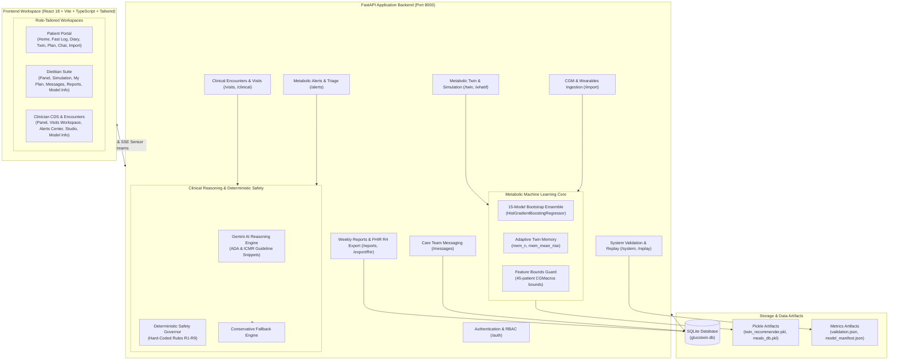

# GlucoTwin: Personalised Metabolic Digital Twin

> **A hybrid, personalised diabetes digital twin with clinician-in-the-loop decision support and deterministic safety governance.**
>
> *Research prototype, not a certified medical device.*

GlucoTwin creates a personalised virtual copy ("metabolic twin") of an individual with Type 2 diabetes. The twin dynamically learns an individual's glycemic responses from meal macros, continuous glucose monitoring (CGM) telemetry, and physical activity to predict postprandial glucose curves, simulate counterfactual lifestyle interventions, and provide guideline-grounded clinical decision support.

---

## System Architecture

GlucoTwin strictly decouples empirical metabolic machine learning from generative clinical reasoning, deterministic safety rules, and longitudinal care workflows:



---

## Role-Based Access Control (RBAC)

The platform provides tailored workspaces ensuring each stakeholder interacts with only the data and tools appropriate to their clinical scope:

| Role | Primary Workspaces | Scope & Key Capabilities |
|---|---|---|
| **Patient** | • Patient Home<br>• Fast Log Meal & Glucose<br>• Metabolic Twin<br>• Glucose Diary & Replay<br>• Meal & Walk Forecast<br>• My 4-Week Plan<br>• Doctor Advice & Plan<br>• My Care Team<br>• Care Team Chat<br>• Data Import<br>• Weekly Reports | **Personal Health Portal**: Allows individuals to log meals with carbohydrate breakdown, review adaptive twin predictions and uncertainty intervals, simulate 15-minute walks and carb swaps, review care plans, communicate with care providers, upload CGM/wearable files, and view synthesized weekly progress. *(Cannot access other patients' records, medical consult SOAP notes, or clinical alert triage).* |
| **Dietitian** | • Patient Panel<br>• Twin Overview<br>• Fast Log Meal<br>• Timeline & Replay<br>• Simulation Lab<br>• 4-Week Care Plan<br>• Treatment Studio<br>• My Care Team<br>• Messages<br>• Data Import<br>• Weekly Reports<br>• About & Model Info | **Nutritional & Lifestyle Optimization**: Allows clinical dietitians to review assigned patients, model meal composition and physical activity what-ifs, track nutritional adherence, manage lifestyle goals in 4-week care plans, message patients and clinicians, and view model cross-validation transparency metrics. *(Excluded from physician-only medical diagnosis visit notes and acute clinical emergency alerts).* |
| **Clinician** | • Clinical Patient Panel<br>• Visit Workspace (Consults)<br>• Metabolic Alerts Center<br>• Twin Overview<br>• Timeline & Replay<br>• Simulation Lab<br>• Treatment Studio<br>• 4-Week Care Plan<br>• Care Team Coordination<br>• Messages<br>• Data Import<br>• Weekly Reports & FHIR<br>• About & Model Info | **Clinical Decision Support (CDS)**: Complete clinical provider suite. Endocrinologists and physicians review panel risk stratification, document formal clinical encounters with SOAP notes and prescription recommendations, triage acute hypoglycemia/hyperglycemia alerts, apply medication scenario counterfactuals with Safety Governor checks, export FHIR R4 bundles, and download clinical PDF dossiers. |
| **Admin** | • Full System Workspaces<br>• Patient Setup & Management<br>• All Clinical & Dietitian Views<br>• Model Registry & Validation | **Full Administration**: Complete access to all clinical, nutritional, and patient tools, including adding synthetic demo patients, testing interoperability pipelines, and verifying model calibration. |

---

## Demo Accounts & Credentials

The system comes pre-seeded with 7 deterministic accounts representing diverse clinical profiles and care team members.

> **Universal Password for All Demo Accounts:**
> ```
> Password123!
> ```

| Email | Role | Name | Clinical Description / Profile |
|---|---|---|---|
| `admin@glucotwin.org` | **Admin** | System Administrator | Full platform administrative access. |
| `dr.chen@glucotwin.org` | **Clinician** | Dr. Michael Chen | Lead Endocrinologist managing complex diabetic patients. |
| `dr.patel@glucotwin.org` | **Clinician** | Dr. Priya Patel | Internal Medicine Specialist focusing on early-stage T2D. |
| `elena.diet@glucotwin.org` | **Dietitian** | Elena Rostova | Clinical Dietitian & Diabetes Educator. |
| `patient.a@glucotwin.org` | **Patient** | Alex Rivera | **Demo Patient A (Cold Start)**: Newly diagnosed, $mem\_n = 0$, baseline cohort predictions. |
| `patient.b@glucotwin.org` | **Patient** | Sarah Connor | **Demo Patient B (Adapted Twin)**: Well-adapted, $mem\_n = 8$, narrow prediction bands. |
| `patient.c@glucotwin.org` | **Patient** | Marcus Vance | **Demo Patient C (Shanghai Hypo)**: Frequent hypoglycemia history; triggers Safety Governor Rule R1/R4 blocking sulfonylureas. |

---

## Getting Started: Running Locally

### Prerequisites
- **Python 3.11+**
- **Node.js 18+** and `npm`

---

### 1. Backend Setup & Startup

1. Open a terminal in the project root and navigate to `backend/`:
   ```bash
   cd backend
   ```

2. Create and activate a Python virtual environment:
   - **Windows (PowerShell):**
     ```powershell
     python -m venv .venv
     .venv\Scripts\Activate.ps1
     ```
   - **macOS / Linux:**
     ```bash
     python3 -m venv .venv
     source .venv/bin/activate
     ```

3. Install backend dependencies:
   ```bash
   pip install -r requirements.txt
   ```

4. Configure environment variables:
   - **Windows (PowerShell):**
     ```powershell
     Copy-Item .env.example .env
     ```
   - **macOS / Linux:**
     ```bash
     cp .env.example .env
     ```
   *(By default, `MOCK_GEMINI=true` is enabled for full offline demonstration without requiring an API key. To enable live Gemini AI generation, insert your `GEMINI_API_KEY` into `backend/.env`).*

5. Seed demo patients and accounts:
   ```bash
   python ../scripts/seed_demo.py
   ```

6. Start the FastAPI server:
   ```bash
   uvicorn app.main:app --reload --port 8000
   ```
   *The interactive OpenAPI Swagger documentation will be available at `http://localhost:8000/docs`.*

---

### 2. Frontend Setup & Startup

1. Open a second terminal window and navigate to `frontend/`:
   ```bash
   cd frontend
   ```

2. Install dependencies:
   ```bash
   npm install
   ```

3. Start the Vite development server:
   ```bash
   npm run dev
   ```
   *The frontend web application will start at `http://localhost:5173`.*

4. Log in using any of the [Demo Accounts](#demo-accounts--credentials) using password `Password123!`.

---

## Running the Automated Test Suites

Both backend and frontend feature comprehensive test suites covering model predictions, memory adaptation math, deterministic safety rules, clinical encounters, messaging, CSV import, and role-based UI flows.

### Run All Backend Tests (pytest)
```bash
# From the backend directory with .venv active:
pytest -v
```
*Current test suite: **102 tests passing**.*

### Run All Frontend Tests (Vitest)
```bash
# From the frontend directory:
npm test -- --run
```
*Current test suite: **75 tests across 10 test files passing**.*

### Frontend Production Bundle Verification
```bash
# From the frontend directory:
npm run build
```

---

## Core Features & Capabilities

- **Adaptive Metabolic Twin**: 15-model bootstrap `HistGradientBoostingRegressor` ensemble that dynamically incorporates observed meals into an individual's twin memory ($mem\_n$). As meals are logged, prediction confidence increases and uncertainty bands narrow.
- **Simulation Lab**: Multi-lever what-if forecasting (carbohydrate adjustment, post-meal 15-minute walks, protein/fat modulation) with realistic physiological damping (`pessimistic_gain`).
- **Deterministic Safety Governor**: Enforces hard-coded clinical contraindications (Rules R1–R9), blocking hazardous medication classes (e.g. blocking sulfonylureas/glinides when hypoglycemia is detected) and scrubbing prescriptive dosing directives.
- **Clinician Visit Workspace**: Structured 3-panel clinical workflow providing patient pre-visit summaries, AI-assisted guideline recommendations, and patient-ready 4-week care plan publishing.
- **Care Team Discussion Hub**: In-app bidirectional messaging linking patient-clinician conversations directly to clinical encounters, active alerts, or simulation scenarios.
- **Data Import**: High-throughput CSV ingestion for continuous glucose monitoring (CGM) telemetry (supporting generic CSV and Abbott FreeStyle Libre exports with automatic mmol/L to mg/dL conversion and de-duplication) and daily wearable steps/sleep.
- **Weekly Clinical Dossier & FHIR Export**: Generates comprehensive multi-page PDF reports and structured FHIR R4 JSON bundles (`Patient`, `Observation` CGM and Wearables, `CarePlan`).
- **About & Model Info**: Read-only model specifications page presenting model version, scikit-learn version, cohort size (45 CGMacros participants, 1,200 meals), grouped cross-validation metrics (+39.1% MAE gain over baseline), and empirical vs nominal interval calibration charts.

---

## Limitations & Responsible Use

> [!IMPORTANT]
> **Research Prototype, Not a Medical Device**
>
> 1. **Decision Support Only**: GlucoTwin is an investigational software prototype designed for academic research, education, and clinical decision support. It is **not** a certified medical device, SaMD (Software as a Medical Device), or diagnostic instrument.
> 2. **Cohort Scope**: The underlying metabolic twin models were trained on observational data from **45 participants** in the CGMacros cohort. Generalizability may vary across demographic groups, pediatric patients, or individuals with complex comorbidities.
> 3. **Generative Projections**: AI-generated therapeutic options are literature-grounded projections intended to inform discussions between licensed physicians and patients—they are **not** prescriptive clinical orders.
> 4. **Clinician Oversight**: Any modification to a patient's pharmacotherapy, insulin regimen, or medical treatment plan requires independent clinical evaluation by a licensed healthcare professional.
